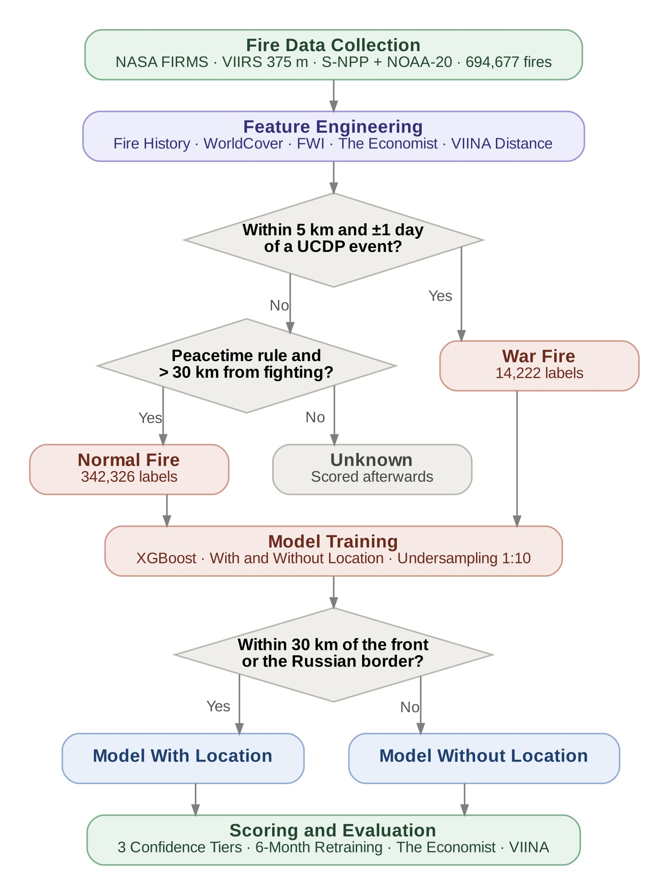

# War Fire Tracker

**Detecting War-Related Fires in Ukraine from Satellite Fire Data**

Satellites recorded 694,677 fire detections in Ukraine between 24 February 2022 and 31 August 2026. Some were caused by shelling, missiles and drones; most were field burning, wildfires and industrial heat. This project labels fires using public data and trains XGBoost models to score each individual fire as war-related or not, and compares the result with The Economist's war-fire model.

The full method and results are in the report, `docs/War_Fire_Tracker_Report.pdf`.

## Methodology

  

1. **Fire data.** NASA FIRMS VIIRS detections for Ukraine, January 2019 to August 2026. Only fires from the start of the invasion (24 February 2022) are classified; pre-war fires are used only to describe each place's normal fire history.
2. **Features.** Each fire gets 14 features: its heat readings (brightness, fire radiative power, confidence), location, land cover, population, pre-war fire history, The Economist's excess-fire signal, month, day or night, and the Fire Weather Index. Its distance to the contact line (from VIINA) and to the Russian border are also measured, but only to build labels and to route fires, not as features.
3. **Labels.** A fire is labelled **war** when it is within 5 km and one day of a UCDP conflict event with a precise date and location. It is labelled **normal** when it matches a peacetime pattern (recurring, agricultural, forest or industrial) and is far from the fighting. Everything else stays **unknown**. Routine heat at factories is moved out of the war labels.
4. **Models.** Two XGBoost models are trained on the labelled fires, with normal fires sampled down to 10 per war fire. One uses the fire's location, the other doesn't. Both are retrained every six months.
5. **Scoring.** Fires within 30 km of the contact line, or of the Russian border on Ukrainian-held land, are scored by the model with location; all others by the model without location. Alerts come in three confidence tiers: both models agree (Tier 1), the setup and The Economist agree (Tier 2), and the setup alone (Tier 3).
6. **Evaluation.** The setup is tested on four six-month periods (July 2024 – June 2026), each scored by models trained only on earlier data, and compared with The Economist's model on the same labels and against VIINA strike reports, which neither method was trained on.

## Main results

Rolling six-month retraining, four test periods (July 2024 – June 2026):

- **Precise alerts.** 65% of the proposed setup's alerts are war fires, and it catches 66% of them. The Economist's model catches 79%, but only 6% of its alerts are war fires.
- **Far fewer alerts.** To catch the same number of war fires, the setup needs 7 to 13 times fewer alerts than The Economist's model.
- **Confidence tiers.** When both models of the setup agree, 87% of alerts are war fires. When the setup and The Economist agree, 77% are.
- **Independent check.** Far from the front, the setup's alerts fall on the day of a nearby strike reported by VIINA 1.7 to 2.6 times more often than chance. The Economist's alerts do no better than fires picked at random.
- **Retraining is essential.** A model trained once and used more than a year later loses most of its skill as the front moves. Retrained every six months, both models stay far above random in every period.

## What is in this repository

| Path | What it is |
|---|---|
| `War_Fire_Tracker_Pipeline.ipynb` | The full pipeline, from the raw data to every number, table and figure in the report. Runs from top to bottom with Run all in Google Colab. Saved with the outputs of a full run. |
| `War_Fire_Tracker_Experiments_Archive.ipynb` | Earlier trials and experiments, with their original outputs and a note on what each one tested and what was decided. A record only: it is not meant to be run. |
| `docs/` | The final report (PDF) and the pipeline diagram (Figure 1). |
| `outputs/tables/` | Every results table as CSV, including `checks_against_report.csv` (every check against the report's numbers). |
| `outputs/figures/` | Every report figure made by code (Figures 2–9). |
| `outputs/models/` | The trained XGBoost models and their alert thresholds, one pair per rolling period. |
| `outputs/environment.json` | The Python and package versions used for the run. |

The input data is **not** in this repository, because the files are too large for Git. It is stored in the "raw" folder in the [War Fire Tracker data folder on Google Drive](https://drive.google.com/drive/folders/1xcJujEm-hI-BIURN6t0FtAJ4Q332456f?usp=drive_link).

## How to reproduce the results

1. Copy the data folder `War_Fire_Tracker/` (with its `raw/` subfolder) into your Google Drive, or add a shortcut to the shared folder in "My Drive".
2. Open `War_Fire_Tracker_Pipeline.ipynb` in Google Colab.
3. In the Settings cell (Section 0.3), check `PROJECT_FOLDER_IN_DRIVE` and set `GEE_PROJECT` to a Google Cloud project registered for Earth Engine.
4. Click **Runtime → Run all**.

The first run takes several hours, mostly for the Earth Engine downloads (land cover and fire weather) and model training. Every slow step saves a checkpoint, so later runs are much faster, and an interrupted Earth Engine step continues where it stopped. The read-me at the top of the notebook explains the settings, the folder layout and each data file.

**How to tell it worked:** at each important step the notebook compares its result with the number in the report and prints ✓ or ⚠. The last section lists all checks in one table. With the data snapshot in the shared folder, every check should show ✓.

**Keep the data snapshot as it is.** FIRMS, UCDP, VIINA and The Economist all update or revise their data, so downloading it again gives slightly different numbers. The checks then show ⚠, which only means the results differ from the report, not that the code is wrong. The notebook's read-me explains how to run it on newer data.

## Data sources

| Data | Used for | Source |
|---|---|---|
| NASA FIRMS VIIRS 375 m active fires (S-NPP, NOAA-20) | The fire detections | firms.modaps.eosdis.nasa.gov |
| UCDP Georeferenced Event Dataset and Candidate Events | War labels | ucdp.uu.se |
| The Economist's war-fire model data | Features and the comparison | The Economist (see the report's References) |
| VIINA (Violent Incident Information from News Articles) | Distance to the contact line, and the independent check | github.com/zhukovyuri/VIINA |
| ESA WorldCover 2021 | Land cover | Google Earth Engine |
| Copernicus Fire Weather Index (Climate Engine) | Fire weather | Google Earth Engine |
| Natural Earth admin-0 countries | Distance to the Russian border | naturalearthdata.com |
